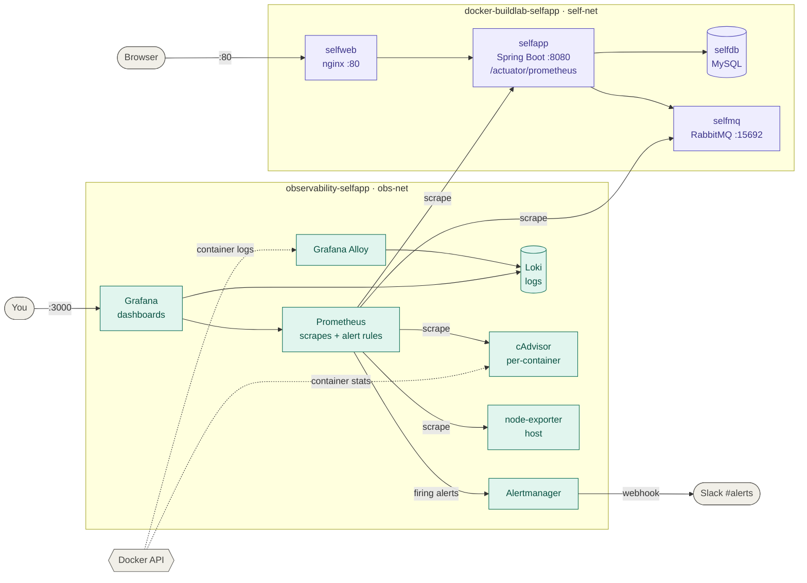

# observability-selfapp

> Metrics, logs, dashboards and Slack alerts for a running three-tier app, with Prometheus, Grafana, Loki, Alloy and Alertmanager in Docker Compose. It attaches to [docker-buildlab-selfapp](https://github.com/alexiglesias/docker-buildlab-selfapp) without changing how the app is deployed, and CI starts both stacks on every pull request to prove that data really flows end to end.

[](https://github.com/alexiglesias/observability-selfapp/actions/workflows/ci.yml)
[](https://prometheus.io/)
[](https://grafana.com/oss/grafana/)
[](https://grafana.com/oss/loki/)
[](https://grafana.com/oss/alloy/)
[](https://prometheus.io/docs/alerting/latest/alertmanager/)
[](https://docs.docker.com/compose/)
[](./LICENSE)

## What's in here

[docker-buildlab-selfapp](https://github.com/alexiglesias/docker-buildlab-selfapp) runs a small Spring Boot app behind nginx, with MySQL and RabbitMQ. This repo is a separate Compose project that joins the app's Docker network and watches it from the outside, the way monitoring is usually added to an existing system:

- **Metrics.** Prometheus scrapes the app's own metrics (requests, errors, latency, JVM) from Spring Boot Actuator, RabbitMQ's built-in exporter, cAdvisor for every container's CPU and memory, and node-exporter for the host.
- **Logs.** Grafana Alloy reads the containers' logs through the Docker API and ships them to Loki.
- **Dashboards.** Two Grafana dashboards are provisioned from JSON in this repo: an application overview that reads from summary tiles down to per-page detail and logs, and a system overview of the host and every container.
- **Alerts.** Ten Prometheus alert rules cover the app, its database, web server, message broker and host. Alertmanager groups them, mutes symptoms while their cause is firing, and posts to Slack with a link to the matching [runbook](docs/runbooks.md).

The app itself only needed one change to be monitored: a metrics endpoint (Micrometer), which nginx keeps off the public port.

## Requirements

- [Docker Desktop](https://www.docker.com/products/docker-desktop/) or Docker Engine with Compose v2 (`docker compose version`). Tested on Docker Desktop on an Apple Silicon Mac and on GitHub's Ubuntu runners.
- [docker-buildlab-selfapp](https://github.com/alexiglesias/docker-buildlab-selfapp) cloned **next to this repo** and running (`docker compose up -d` in it). This stack joins its network.
- About **2 GB of free memory** for both stacks together, and **3 GB of disk** for the images.
- Optional: a free Slack workspace for the alerts (see [Slack alerts](#slack-alerts)). Without it, everything else works and alerts stay visible in Alertmanager.
- Optional, for development: `brew install pre-commit`.

## Architecture



Prometheus is the only monitoring container on the app's network. It reaches `selfapp` and `selfmq` by name; everything else stays on this stack's own network. Every published port is bound to `127.0.0.1`, so nothing is reachable from the rest of your network.

| Service | Image | Role | URL |
|---|---|---|---|
| Prometheus | `prom/prometheus:v3.15.1` | Scrapes 5 targets every 15 s, evaluates the alert rules | http://localhost:9090 |
| Alertmanager | `prom/alertmanager:v0.34.1` | Groups, routes and inhibits alerts; posts to Slack | http://localhost:9093 |
| Grafana | `grafana/grafana:13.2.4` | Dashboards and data sources, provisioned from this repo | http://localhost:3000 |
| Loki | `grafana/loki:3.7.9` | Stores logs, 7 days' retention | http://localhost:3100 (API) |
| Grafana Alloy | `grafana/alloy:v1.21.2` | Collects the two Compose projects' container logs | http://localhost:12345 |
| cAdvisor | `ghcr.io/google/cadvisor:0.60.6` | Per-container CPU, memory and network | http://localhost:8085 |
| node-exporter | `prom/node-exporter:v1.12.1` | Host CPU, memory, disk, network | (internal) |

## Quick start

```bash
# 1. The app, if it isn't running yet
git clone https://github.com/alexiglesias/docker-buildlab-selfapp.git
cd docker-buildlab-selfapp && cp .env.example .env   # set the three passwords
docker compose up -d --build && cd ..

# 2. This stack
git clone https://github.com/alexiglesias/observability-selfapp.git
cd observability-selfapp && cp .env.example .env     # set GRAFANA_ADMIN_PASSWORD (+ SLACK_WEBHOOK_URL)
make up                                              # waits until every service is healthy
```

Open **http://localhost:3000** (user `admin`, the password from `.env`) → **Dashboards → selfapp**, then click around the app at http://localhost to give the dashboards some traffic.

### Slack alerts

1. Create a `#alerts` channel in a Slack workspace you own.
2. At https://api.slack.com/apps: **Create New App → From scratch**, then **Incoming Webhooks** → on → **Add New Webhook** → `#alerts`.
3. Put the URL in `.env` as `SLACK_WEBHOOK_URL` and run `make up` again.

The webhook only ever lives in the git-ignored `.env`. Alertmanager's config can't read environment variables, so Compose mounts the value as a secret file (`/run/secrets/slack_webhook`) in the Alertmanager container only, and the config points at it with `slack_api_url_file`.

## The make targets

| Target | What it does |
|---|---|
| `make up` | Checks the app's network exists, starts the stack and waits until it's healthy |
| `make down` | Stops the stack, keeps its data |
| `make status` / `make logs` | Containers with their health / follow the logs |
| `make check` | Validates `docker-compose.yml`, the Prometheus, Alertmanager and Alloy configs, the dashboards' JSON and the scripts. No running stack needed |
| `make test` | Alert-rule unit tests (`promtool test rules`) and Alertmanager routing tests |
| `make e2e` | End-to-end test against the running stacks (see [How it's tested](#how-its-tested)) |
| `make incident MODE=cpu\|app\|db` | Causes a real incident on purpose to watch an alert fire and resolve |
| `make clean` | Stops the stack and deletes all its data, after asking |

`make check` and `make test` run each tool from the same pinned image the stack uses, read from `docker-compose.yml`, so they need nothing but Docker and stay in step with the versions Dependabot updates.

## Dashboards, queries and alerts

**selfapp - Application Overview** starts with six tiles whose colours use the same thresholds as the alerts (app up, requests/s, 5xx %, p95 response time, JVM heap, RabbitMQ consumers), then HTTP detail per page, container CPU and memory, RabbitMQ message flow, and logs with `container` and `search` filters. **selfapp - System Overview** shows the host and every container, including the monitoring stack itself.

Three of the queries behind them, all excluding Actuator traffic (Prometheus's own scrapes and Docker's healthchecks), which would otherwise outnumber real users:

```promql
# Requests per second, per page and status code
sum by (uri, status) (rate(http_server_requests_seconds_count{job="selfapp", uri!~"/actuator.*"}[5m]))

# Share of requests that failed with a server error (alert: above 5% for 5 minutes)
sum(rate(http_server_requests_seconds_count{job="selfapp", status=~"5..", uri!~"/actuator.*"}[5m]))
  / sum(rate(http_server_requests_seconds_count{job="selfapp", uri!~"/actuator.*"}[5m]))

# 95th percentile response time, from the request histograms (alert: above 1s for 5 minutes)
histogram_quantile(0.95, sum by (le) (rate(http_server_requests_seconds_bucket{job="selfapp", uri!~"/actuator.*"}[5m])))
```

| Alert | Severity | Fires when |
|---|---|---|
| `InstanceDown` | critical | A scrape target is unreachable for 1 minute |
| `ContainerDown` | critical | `selfdb` or `selfweb` disappears from cAdvisor for 1 minute (neither exposes metrics, so `up` can't see them) |
| `SelfappHighErrorRate` | warning | More than 5% of requests return 5xx for 5 minutes |
| `SelfappSlowResponses` | warning | p95 response time above 1 s for 5 minutes |
| `SelfappHighHeapUsage` | warning | JVM heap more than 90% full for 10 minutes |
| `RabbitMQNoConsumers` | warning | No consumer on RabbitMQ's queues for 2 minutes |
| `RabbitMQMessagesPilingUp` | warning | More than 100 messages waiting for 5 minutes |
| `HighCPUUsage` / `HighMemoryUsage` / `LowDiskSpace` | warning | Host CPU above 80%, memory above 90%, disk above 90% |

Critical alerts repeat every 30 minutes, warnings every 3 hours. While `InstanceDown` fires for a job, that job's warnings are inhibited, so Slack shows the cause rather than its symptoms. Each message links to its section in [docs/runbooks.md](docs/runbooks.md): what it means, what to check and how to fix it.

## Cost

**$0.** Everything runs locally from open-source images; Slack's free plan and GitHub Actions on a public repo are free.

What it uses on the machine, measured on Docker Desktop:

| | Memory | Disk |
|---|---|---|
| This stack (7 containers) | ~0.7 GB | ~2 GB of images, plus up to 7 days of logs and 15 days of metrics |
| The app (4 containers) | ~1 GB | ~1 GB of images, plus the MySQL volume |

`make down` frees the memory and keeps the data; `make clean` deletes the data too.

## How it's tested

- **`make test`**: 7 `promtool` unit tests feed made-up metrics into the alert rules and check which alerts fire, when, and with which text. They include waiting cases (down for 15 s must not fire yet) and quiet cases (1% errors, or failing healthchecks, must not fire). Two `amtool` tests check that critical alerts and warnings reach the right Slack receiver.
- **`make check`** validates every config with the real tools at the stack's versions: `docker compose config`, `promtool check config`, `amtool check-config`, `alloy validate`, plus JSON and ShellCheck.
- **pre-commit** runs on every commit: whitespace and end-of-file fixes, YAML/JSON syntax, yamllint, ShellCheck, gitleaks (it blocks a Slack webhook URL), and `make check` / `make test` when a file they cover changes.
- **GitHub Actions** runs on every pull request and push to `main`. The first job runs the hooks, `make check` and `make test`. The second starts the real app and this stack on the runner, with throwaway passwords, and runs `tests/e2e.sh`, which checks that data actually flows:
  1. all 5 Prometheus targets are up and the app's request metrics arrive;
  2. Grafana's data sources pass their health check and both dashboards are loaded;
  3. Loki has fresh log lines for requests just sent;
  4. stopping `selfapp` gets `InstanceDown` into Alertmanager (Slack isn't contacted from CI).
- **By hand on Docker Desktop (Apple Silicon)**: `make incident MODE=app`, `MODE=db` and `MODE=cpu` each produced a FIRING message in Slack with its runbook link, followed by RESOLVED once the script restored things. `app` also produced `RabbitMQNoConsumers`, because the app is RabbitMQ's only consumer.
- **Dependabot** proposes new image and GitHub Actions versions weekly; CI tests each one before it can be merged.

The end-to-end test earned its place on its first run: it found that Alloy had been collecting no logs at all. Its Docker filter listed both Compose projects as label values, and Docker requires *all* listed labels to match, so no container ever did. No component reported an error. Checking that containers are up would have passed; checking that data flows didn't.

## Troubleshooting

| Symptom | Likely cause |
|---|---|
| `Docker network '…_self-net' not found` | Start docker-buildlab-selfapp first. If you cloned it into a differently named folder, its network is `<folder>_self-net`: set `SELFAPP_NETWORK` in `.env` |
| `selfapp` target DOWN with "text/html" or a 302 | The app runs a version without the metrics endpoint. Pull docker-buildlab-selfapp and `docker compose up -d --build` |
| Container CPU/memory panels empty on Docker Desktop | cAdvisor can't name containers: it needs `/var/run/docker.sock` and, with Docker Desktop's containerd image store, `/run/containerd/containerd.sock`. Check with `docker logs obs-cadvisor 2>&1 \| grep "docker container factory"` |
| Grafana restarts in a loop: `Datasource provisioning error: data source not found` | An existing Grafana database holds the data sources under other UIDs, and Grafana won't change them. Dashboards and data sources come from this repo, so: `docker compose rm -sf grafana && docker volume rm observability-selfapp_grafana-data && make up` |
| Dashboards show "No data" right after resetting or upgrading Grafana | The browser still runs the old Grafana page. Hard-reload (Cmd+Shift+R) |
| `/-/reload` says `no such file or directory` | A single-file bind mount still points at a file that was replaced (by `git switch` or an editor). Prometheus mounts its whole folder for this reason; for the other services, `docker compose up -d --force-recreate <service>` |
| A container stays `unhealthy` | Read its healthcheck results: `docker inspect --format '{{range .State.Health.Log}}{{.Output}}{{end}}' <container>` |
| `selfapp` unhealthy, logs show `Access denied` or `Unable to determine Dialect` | MySQL kept the passwords from when its volume was created. In docker-buildlab-selfapp: `docker compose down -v`, then `up -d` |
| `grep` doesn't filter `docker logs` output | Many containers log to stderr: use `docker logs <c> 2>&1 \| grep …` |
| `make check` says a file you just created "does not exist" | Docker Desktop's file sharing can lag for a few seconds on new files. Run it again |
| No Slack messages | `make up` warns if `SLACK_WEBHOOK_URL` is still the placeholder; otherwise `docker logs obs-alertmanager 2>&1 \| grep -i slack` |

## Project structure

```
observability-selfapp/
├── docker-compose.yml          # 7 services, healthchecks, localhost-only ports, Slack secret
├── .env.example                # template for .env: Grafana password, Slack webhook, app network
├── Makefile                    # run `make` to list every target
├── prometheus/
│   ├── prometheus.yml          # 5 scrape jobs, Alertmanager address
│   └── alert.rules.yml         # 10 alert rules in 4 groups, each with a runbook link
├── alertmanager/
│   └── alertmanager.yml        # grouping, critical/warning routes, inhibition, Slack messages
├── alloy/
│   └── config.alloy            # Docker discovery -> keep the 2 projects -> labels -> Loki
├── loki/
│   └── loki-config.yml         # single-node, filesystem storage, 7-day retention
├── grafana/
│   ├── provisioning/           # data sources (fixed UIDs) and the dashboard folder
│   └── dashboards/             # Application Overview, System Overview (JSON)
├── scripts/
│   ├── up.sh / down.sh         # start (network check + wait for healthy) / stop
│   └── simulate-incident.sh    # cpu | app | db incident, always restored
├── tests/
│   ├── alert.rules.test.yml    # promtool unit tests for the alert rules
│   └── e2e.sh                  # end-to-end test of the running stacks
├── docs/
│   └── runbooks.md             # what to do for each alert
├── .github/
│   ├── workflows/ci.yml        # lint + unit tests, then end-to-end with both stacks
│   └── dependabot.yml          # weekly image and action updates
└── .pre-commit-config.yaml  .yamllint.yml  .shellcheckrc
```

Part of the selfapp series:

- [`docker-buildlab-selfapp`](https://github.com/alexiglesias/docker-buildlab-selfapp): the app this stack monitors
- [`k8s-selfapp-minikube`](https://github.com/alexiglesias/k8s-selfapp-minikube): the same app on Kubernetes, as a Helm chart
- [`cicd-github-actions-selfapp`](https://github.com/alexiglesias/cicd-github-actions-selfapp): CI/CD pipeline for the app's images

## License

[MIT](./LICENSE)
